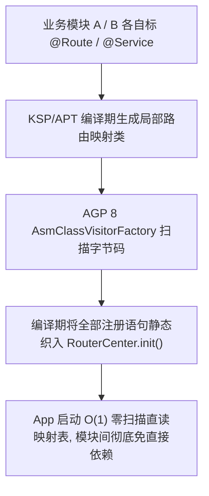

## 面试答题思路

- **组件化核心分层架构（拒绝网状互相依赖）**：自上而下严格单向依赖——**壳工程 `app`（仅组装路由、Application） → 平行互不直接依赖的业务模块 `feature-home`/`feature-pay` → 下沉公共契约层 `service-api`/`common-ui` → 基础底座 `core-network`/`core-base`**。
- **跨模块通信两件事**：
  1. **调用服务/方法（如首页调支付能力或拉取用户信息）**：采用 **“接口下沉 + SPI（`ServiceLoader` / `Hilt` 多绑定 `@IntoMap`）”**，业务模块实现接口注册，调用方只依赖下沉的接口模块；
  2. **跨模块跳转页面与拦截（Router）**：早期 ARouter 用 **KAPT/APT 编译期生成路由映射类 + 运行期在 `DexFile` 里全量遍历查找指定包名下的映射类**（启动耗时数百毫秒且容易被安全扫描误判）；现代最佳实践是编译期通过 **AGP 8 的 `AsmClassVisitorFactory` 字节码插桩（替代已彻底移除的旧 `Transform API`）** 在编译打包瞬间自动把所有路由表注册代码静态织入一个中心加载类的 `init()` 方法中，**运行期 O(1) 零反射极速加载**！

## 核心原理解析

### 1. 为什么传统路由启动期“扫描 Dex 查找路由类”被淘汰？
早年路由库在 `Application.onCreate()` 调 `ARouter.init()` 时开启线程池遍历当前 APK 的所有 `DexFile` 类名列表匹配 `com.alibaba.android.arouter.routes.*`：
- 当业务膨胀到几万个类与十几个分包 Dex 时，冷启动扫全量 Dex 类表可能耗时 **200ms–600ms** 甚至引发主线程等待掉帧；
- **现代极速解法（编译期字节码收集自动注册）**：在 Gradle 编译最后阶段遍历生成出来的中间字节码（通过 `AsmClassVisitorFactory` 访问类字节码），发现实现了 `IRouteRoot` 的生成类就把 `register(new Route$$FeaturePay())` 直接用 ASM 写进 `RouterCenter.loadAll()` 方法字节码里，冷启动几乎 **0 毫秒扫描开销**！

### 2. AGP 8+ 为什么移除旧 `Transform API`，改用 `AsmClassVisitorFactory`？
过去老旧 `Transform API` 每次打包都要把全部 `.class`/`.jar` 从盘里掏出来写一遍又落回去，不支持多插件并发与良好缓存（严重拖慢 Gradle 构建）；**Android Gradle Plugin 8.0 彻底删掉了 `Transform API`**，官方推出基于 **`AndroidComponentsExtension` + `Instrumentation` (`AsmClassVisitorFactory`)**：它允许多个插桩插件共享同一遍 ASM 解析流水线，且天生支持增量编译与 Gradle Configuration Cache，是目前开发热修复、无痕埋点与路由注册插件的唯一标准路线。

## 图解流程

## 高频追问与关键词

- **追问 1**：除了实现跳转，一个成熟的路由框架通常还要解决哪些核心实际问题？
  - 关键词：① **登录态/实名认证拦截器链（`Interceptor`）**（拦截跳下单页时自动挂起跳登录页，登录成功自动续跳原目的地）；② **H5/外部 DeepLink 统一路由分发**；③ **单模块独立运行调试（`isApp` 开关切换 `application`/`library` 插件独立跑起某个 Feature 模块）**。
- **追问 2**：如果用 `Hilt` 做组件化跨模块服务注入，还需不需要额外写一套反射 SPI 路由来拿服务实例？
  - 关键词：不需要！若全工程统一接入了 Hilt，只需要把服务接口（如 `UserService`）下沉进公共 `api` 模块，各业务模块用 **`@Binds @Singleton`** 绑定实现类并通过 `@InstallIn(SingletonComponent::class)` 贡献给全局图，调用方直接 `@Inject lateinit var userService: UserService` 编译期直接零反射注入完毕，比传统运行时字符串找服务安全得多。

## 延伸参考

参考 Android Developers 官方 App Modularization 指南与 AGP ASM Bytecode Instrumentation 官方扩展文档。
