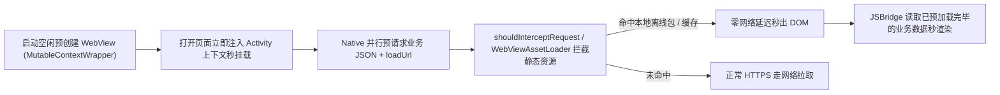

## 面试答题思路

- **H5 页面为什么首开慢？**：耗时主要卡在四个串行阶段：**WebView 内核冷初始化与进程拉起 → 网络建连下载主 HTML → 解析构建 DOM 并串行拉 JS/CSS → 调客户端 API 拉业务数据渲染**。
- **秒开体系化四板斧**：
  1. **独立进程隔离（`android:process=":web"`）**：`WebView` 底层依赖几十 MB 至上百 MB 的 Chromium Native 内存且极易发生底层渲染器 Crash；放到独立进程彻底防止拖垮主进程 OOM 闪退（多进程需通过 AIDL/ContentProvider 回传登录态，也可用现代 `RenderProcessGone` 机制挽救）；
  2. **全局 `WebView` 预创建复用池 + 预加载**：App 启动后空闲时（`IdleHandler`）往池里预实例化一个挂载 **`MutableContextWrapper`** 的空白 WebView（提前走完 Chromium 内核初始化），进页面直接换上 `Activity` Context 挂载；
  3. **资源拦截与离线包（`shouldInterceptRequest`）**：提前下发 H5 静态资源包或核心 JS/CSS 模板，拦截对应静态请求直接返回本地输入流（**零网络延迟**），现代推荐用官方 **`WebViewAssetLoader`** 把本地资源映射为同源 `https://appassets.androidplatform.net/...` 避免 `file://` 跨域问题；
  4. **接口并行预请求**：Native 打开 WebView 容器的同时顺便并发发起业务数据请求缓存在内存，等前端加载好 JSBridge 一调即秒吐数据。

## 核心原理解析

### 1. `WebView` 经典内存泄漏与销毁规范
切忌在 XML 里直接静态写 `<WebView />`，因为一旦写进 XML 它构造期直接强绑死宿主 `Activity` Context！
- **标准动态创建与销毁步骤**：
  1. 代码里用 **`MutableContextWrapper(applicationContext)`** 创建并存入占位 `FrameLayout`；进入页面替换 `baseContext = activity`，退出时先换回 `applicationContext`；
  2. 在 `onDestroy()` 按严格顺序清洗：`stopLoading()` → `clearHistory()` → `removeAllViews()` → 从父容器 `parent.removeView(webView)` 摘除 → 最后调用 **`webView.destroy()`**（独立进程甚至可在彻底退出且无其他 Web 页面时直接杀进程彻底归零 Native 内存）。

### 2. 白屏监控与渲染进程崩毁挽救（`onRenderProcessGone`）
- **白屏检测**：在 `onPageFinished` 后延迟抽样缩小截屏像素比对纯色占比（判断是否为全白/单色崩溃页），结合 JS `window.__pageReady` 心跳上报或展示兜底重试页；
- **Android 8.0+ `onRenderProcessGone()`**：一旦底层独立渲染子进程内存爆掉被系统杀掉，如果不重写 `WebViewClient.onRenderProcessGone()` 并返回 `true`，系统直接连带崩掉整个主应用进程！重写它即可优雅销毁失效 `WebView` 实例并无感重新加载恢复。

## 图解流程

## 高频追问与关键词

- **追问 1**：为什么 H5 在 `WebView` 里配置自定义请求拦截返回本地磁盘文件时，直接塞 `file:///...` 会遇到跨域报错，官方怎么推荐？
  - 关键词：现代 Chromium 内核处于安全策略默认禁用了 `file://` 协议发起 `fetch`/`XHR` 跨源读取同级本地脚本；官方提供 Jetpack **`WebViewAssetLoader`** 将 APK `assets/` 或私有目录文件伪装映射到合法安全的同源虚拟域名 `https://appassets.androidplatform.net/assets/...` 下加载，完美解决 CORS 报错且支持 ES Module。
- **追问 2**：WebView 独立 `:web` 进程会带来哪些通信与 Cookie 痛点？怎么解决？
  - 关键词：① 登录态/用户信息等接口无法直接读取主进程内存单例，需封装基于 Binder/AIDL 或 ContentProvider 的跨进程 JSBridge 分发总线；② 在 Android 8+ 后 `CookieManager` 需通过 `CookieManager.getInstance().flush()` 及时落盘同步，注意避免首次启动 `:web` 进程拉起冷耗时抵消收益（可在主进程首帧后静默预热拉起 `:web` 空进程）。

## 延伸参考

参考 Android Developers WebView 开发指南与 `WebViewAssetLoader` API 文档。
