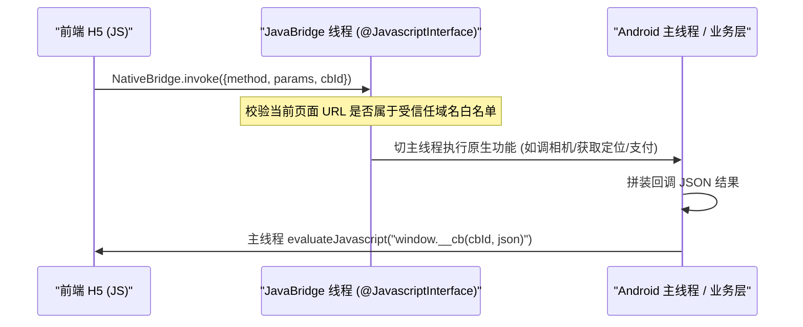

## 面试答题思路

- **双向交互两大方向**：
  1. **Native 调用前端 JS**：现代标准唯一推荐 **`webView.evaluateJavascript("window.onNativeEvent(...)", callback)`**（必须在主线程调用，不刷新页面，直接通过 `ValueCallback<String>` 异步拿到 JS 返回值；彻底淘汰老旧阻塞且会引发界面闪烁重绘的 `loadUrl("javascript:...")`）；
  2. **前端 JS 调用 Native**：主要有三种协议实现——**`@JavascriptInterface` 对象映射注入**（最主流高性能，API 17+ 安全）、**URL Scheme 伪协议拦截**（`shouldOverrideUrlLoading` 截获 `jsbridge://action?params=...`）、**`WebChromeClient.onJsPrompt` 弹窗拦截**（可同步拿到 Native 返回值）。
- **四大必考安全与坑点防线**：
  1. **防高危远程代码执行（RCE）**：老 `addJavascriptInterface` 在 Android 4.2 以下存在反射 `getClass().forName("java.lang.Runtime")` 漏洞（现 `minSdk` 普遍 >=21 已修复，但仍严禁向 JS 暴露非 `@JavascriptInterface` 方法，并禁用 `setAllowFileAccessFromFileURLs`）；
  2. **严格的域名白名单校验**：加载任意第三方外链网页（如用户发出来的钓鱼外链）时，**绝对不能注入包含支付/登录态读取能力的 JSBridge 对象**！每次桥接调用前核对 `webView.url` 域名白名单；
  3. **R8 混淆保护**：注入的桥接类方法务必加 `@Keep` / `-keepattributes *Annotation*` 防方法名被混淆导致 H5 调用找不到；
  4. **线程切换**：`@JavascriptInterface` 方法回调运行在 **WebView 私有后台子线程（`JavaBridge` 线程）**，内部更新 UI 必须切回主线程！

## 核心原理解析

### 1. 异步桥接通信协议设计（RequestId + Callback 机制）
前端通过 `window.NativeBridge.postMessage(jsonStr)` 发请求（含 `method`、`params`、`callbackId`）给 Android；Android 在工作线程或主线程完成选图/网络请求/支付后，拼装好结果再调用：
`webView.post { webView.evaluateJavascript("window.__bridgeCallback('$callbackId', $resultJson)", null) }`
让前端精准唤起对应 `Promise.resolve(...)` 完成完整的异步双向 RPC 闭环！

### 2. URL Scheme 拦截 vs `@JavascriptInterface` 的抉择
- **`shouldOverrideUrlLoading` 拦截 Scheme**：优点是同时兼容早期 iOS UIWebView 与 Android 4.1 之前极其古老的浏览器环境，且天然按指令字符串路由方便与外部 DeepLink 合并校验；**缺点**：每次拦截受 URL 长度上限约束且连续快速发送多个消息时，若前端直接改 `location.href` 后发消息会覆盖前一条导致丢失（前端必须自己维护 `iframe` 消息发送队列）；
- **`@JavascriptInterface` 原生注入**：传参无长度限制（支持大 JSON/Base64）、零 iframe 队列延迟、性能极高。现代项目（`minSdk >= 21`）全面首选 **`@JavascriptInterface`（配 `@Keep` + 域名校验 + 统一 JSON 协议封装）** 或 Jetpack `WebMessageCompat`（官方双向通信通道，天然支持按 Origin 隔离权限）。

## 图解流程

## 高频追问与关键词

- **追问 1**：在 `@JavascriptInterface` 标的方法里直接弹一个 Toast 或者改原生 Toolbar 标题会怎样？
  - 关键词：直接操作原生 UI 视图树极大概率抛出 `CalledFromWrongThreadException` 崩溃！因为 Chromium 内核是通过独立的 **`JavaBridge` 后台工作线程**执行注入方法的回调，必须显式通过 `runOnUiThread` / `Handler(Looper.getMainLooper())` 切回主线程才能操作界面，而且要注意判断宿主页面是否已销毁防泄漏。
- **追问 2**：如何在不暴露敏感接口给外部任意网页的情况下安全使用 JSBridge？
  - 关键词：① 在 `WebViewClient` 打开第三方不可信外链前移除桥接或用独立受限无桥接实例加载；② 每次执行 `@JavascriptInterface` 敏感能力时，**在主线程读取 `webView.url` 解析 `Uri.host` 验证是否精确匹配公司受信白名单域名且为 `https://`**；③ 若使用 Jetpack Webkit 的 **`WebViewCompat.addWebMessageListener`**，引擎层原生支持直接限定 `allowedOriginRules` 白名单域名集合，从根源拦截未授权域通信！

## 延伸参考

参考 Android Developers WebView JavaScript 绑定文档与 Unsafe WebView 安全防御指南。
