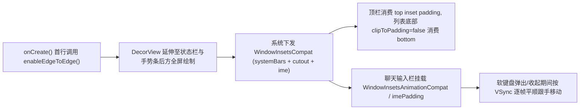

## 面试答题思路

- **彻底告别硬编码 `getStatusBarHeight` 反射 hack**：不同折叠屏、挖孔屏、三键导航栏与小白条手势导航高度千差万别；现代标准用 **`WindowInsetsCompat`** 统一描述屏幕四周受系统遮挡的安全内边距，并在 `Activity.onCreate()` 第一行调用 Jetpack 的 **`enableEdgeToEdge()`**（且注意 **Android 15/16 起 targetSdk 35+ 已经系统级强制开启 Edge-to-Edge**，不适配就会出现顶部标题被状态栏盖住、底部按钮被手势条挡住的严重 Bug！）。
- **核心类型分工**：
  - `WindowInsetsCompat.Type.systemBars()`：状态栏 + 底部导航栏合并区域；
  - `WindowInsetsCompat.Type.displayCutout()`：屏幕挖孔 / 刘海区；
  - `WindowInsetsCompat.Type.ime()`：系统软键盘弹出区域（配合 `WindowInsetsAnimationCompat` 实现输入法弹起时聊天框**丝滑逐帧跟手跟随上升**，告别老式 `adjustResize` 生硬一跳）。

## 核心原理解析

### 1. `enableEdgeToEdge()` 底层帮你做了什么？
只需在 `super.onCreate()` 之前调用 `enableEdgeToEdge(statusBarStyle, navigationBarStyle)`：
1. 自动调用 `WindowCompat.setDecorFitsSystemWindows(window, false)` 让页面内容穿透延伸到系统状态栏和底部导航栏后面全屏绘制；
2. 将状态栏设为透明并根据深浅色模式自动切换 **`WindowInsetsControllerCompat.isAppearanceLightStatusBars`**（深字还是浅字图标）；
3. 处理低版本（API 21–28）缺少透明导航栏亮色图标支持时的半透明兜底色遮罩，彻底统一各版本沉浸式观感。

### 2. View 与 Compose 分别怎么精准消费 Insets？
- **传统 View**：使用 **`ViewCompat.setOnApplyWindowInsetsListener(targetView) { v, windowInsets -> ... }`** 取出 `insets.getInsets(Type.systemBars() or Type.displayCutout())` 转化成对应控件的 `paddingTop`/`paddingBottom`/`margin`，如果是滚动列表（如 `RecyclerView`）只需加 `paddingBottom` 并配合 **`android:clipToPadding="false"`**，列表内容就能在透明导航栏后面丝滑滚过同时最后一条又刚好停在导航栏上方不被挡住！
- **Jetpack Compose**：极其优雅，直接调用 **`Modifier.windowInsetsPadding(WindowInsets.safeDrawing)`**、**`Modifier.statusBarsPadding()`**、**`Modifier.imePadding()`** 或直接传入 `Scaffold` 的 `contentWindowInsets` 与 `innerPadding`。

## 图解流程

## 高频追问与关键词

- **追问 1**：如果在 `RecyclerView` 的不同 Fragment 之间切换，为什么有时第二个 Fragment 的 `OnApplyWindowInsetsListener` 收不到 Insets 回调？
  - 关键词：如果第一个 Fragment 处理完后错误地返回了 **`WindowInsetsCompat.CONSUMED`**（消费并吞掉了 Insets），或者容器在非 Attached 状态下没触发重新请求，同级后续视图就拿不到内边距！规范写法是返回未完全吃掉的原始 `windowInsets`（仅扣减自己确实消费掉的部分）并在 `ViewAttachedToWindow` 时调 `ViewCompat.requestApplyInsets(view)`。
- **追问 2**：Android 15（API 35）与 Android 16（API 36）强制 Edge-to-Edge 后，老页面怎么快速避坑不崩界面？
  - 关键词：核心检查四大位置——顶部自定义标题栏加 `statusBars` 上内边距、底部悬浮按钮/底栏加 `navigationBars` 下内边距、全屏弹窗/Dialog 注意默认 WindowInsets、横屏挖孔屏额外合并 `displayCutout()`（并注意 Android 16 取消了 `windowOptOutEdgeToEdgeEnforcement` 豁免属性）。

## 延伸参考

参考 Android Developers Display Content Edge-to-Edge 与软键盘动画官方指南。
