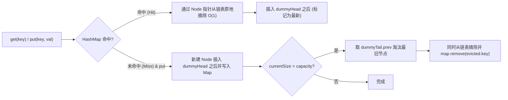

## 面试答题思路

- **手写核心（30 秒架构拆解）**：LRU（Least Recently Used）要求 **`get` 和 `put` 均达到 `O(1)` 时间复杂度**。单一数据结构无法同时满足：哈希表查找 `O(1)` 但无序，链表移动/删除 `O(1)` 但查找 `O(n)`。因此标准解法是 **HashMap + 双向链表**：Map 存 `key -> Node` 引用定位，双向链表维护访问时序（头部最新，尾部最旧）。
- **手撕防 Bug 黄金技巧**：
  1. 维护一对**虚拟哨兵节点（`dummyHead` / `dummyTail`）**，彻底消除空链表、首节点、尾节点的判空分支；
  2. 节点自身必须保存 `key`，因为淘汰链表尾节点时，需要根据尾节点 `key` 去 HashMap 里删除对应索引。
- **Android 源码差异点**：`android.util.LruCache` 内部直接封装了 **`LinkedHashMap(0, 0.75f, true)`**，并在此之上通过 **`synchronized (this)`**、**`sizeOf()`** 字节计量与 **`entryRemoved()`** 复用回调，适配移动端图片/对象缓存场景。

## 核心原理解析

### 1. 为什么必须用“双向链表”而不是单向链表？
执行 `get(key)` 或更新已存在节点时，不仅需要找到它，还要把它从链表中间**摘除**再插到链表头部。若用单向链表，摘除节点需要知道其前驱节点 `prev`，只能从头遍历 `O(n)`；双向链表直接持有一手 **`node.prev` 与 `node.next`** 指针，改写 4 个引用即可实现真正 `O(1)` 原地摘除与头插。

### 2. Android `LruCache` vs Java `LinkedHashMap`
- **`LinkedHashMap` 原理**：在 `HashMap` 节点基础上额外维护了一条全局 `before/after` 双向链表；构造函数第 3 个参数 `accessOrder = true` 时，每次 `get()`/`put()` 都会触发 `afterNodeAccess()` 把节点挪到链表尾部（默认 `false` 仅按插入顺序）；`put()` 后可重写 `removeEldestEntry()` 淘汰最老节点。
- **Android `LruCache` 做了哪些工程增强？**
  1. **容量单位从“条目数”改为“自定义权重/字节数”**：重写 `sizeOf(key, value)`（如 Bitmap 传 `allocationByteCount / 1024` KB），`trimToSize(maxSize)` 会在超出阈值时循环淘汰最久未用项，防止大图只存 10 张却撑爆几十 MB 堆内存；
  2. **线程安全**：关键读写方法均对内建锁加 **`synchronized`**，而原生 `LinkedHashMap` 非线程安全；
  3. **强/软引用选型**：废弃早期的 `SoftReference` 内存缓存（ART 下软引用过早回收导致抖动），改用固定上限强引用配合 `entryRemoved()` 通知外部（如 Glide 转入 `BitmapPool` 复用或进入活跃引用计数）；
  4. **禁止 `null` key/value**：直接抛 `NullPointerException`，避免把缓存未命中与值为空混淆。

## 图解流程

## 高频追问与关键词

- **追问 1**：如果多线程高并发读写 LRU 缓存，`synchronized` 锁整张表性能不够怎么办？
  - 关键词：分段锁（参考 `ConcurrentHashMap` 按 key hash 分桶成多个独立 LRU 分片减少锁竞争）、或者读多写少场景采用 **“只读先查无锁 Map / 异步队列合并刷新访问顺序”**（如 Caffeine 的 ReadBuffer/WriteBuffer 与 W-TinyLFU 思路）。
- **追问 2**：LRU 在“偶发性全表扫描/批量预加载”下有什么缺陷？如何演进为 LRU-K 或 W-TinyLFU？
  - 关键词：传统 LRU 对“只访问 1 次的冷门批量数据”同样塞进头部会导致**缓存污染**把高频热点挤出；`LRU-K` 维护历史队列只有访问满 `K` 次才晋升主缓存；`LFU` 按频次淘汰但有旧热点占坑问题，现代缓存（Glide/OkHttp/Caffeine）结合衰减轻权重与频率统计避免突发流量击穿热点。

## 延伸参考

参考 Android Developers `LruCache` 官方文档与 Bitmap 缓存最佳实践。
