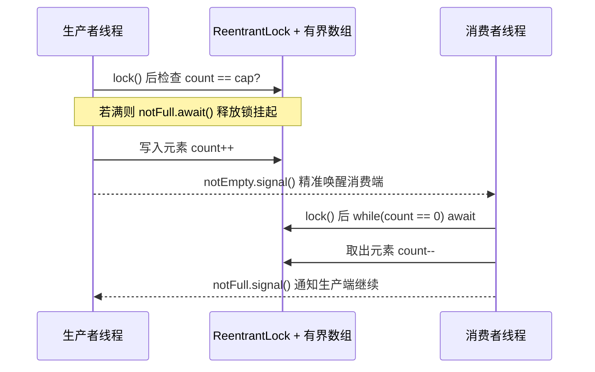

## 面试答题思路

- **多线程协调两大经典题型**：
  1. **顺序交替控制（如 3 线程交替打印 `A-B-C` 10 次）**：核心是“**共享状态位 + 条件等待 + 精准或全量唤醒**”；最干净的写法是 `ReentrantLock` 配合 **3 个独立 `Condition`**（精确唤醒下一个线程），或者 3 个初始许可分别为 `1, 0, 0` 的 `Semaphore` 链式 `acquire`/`release`；
  2. **生产者-消费者模型**：本质是一个**线程安全的有界缓冲区（Bounded Buffer）**，核心解决两件事：**队列满时阻塞生产者、队列空时阻塞消费者**，工程里可直接讲 `ArrayBlockingQueue` 源码思想或用 Kotlin 协程 `Channel(capacity)` 对比加分。
- **面试手写最易扣分的 3 个坑**：
  - 等待条件必须用 **`while (!condition)`** 而不是 `if`，防止**虚假唤醒（Spurious Wakeup）**和多线程竞争条件再次失效；
  - 用 **`notifyAll()`** 替代 `notify()`（单 `Condition` 下 `notify()` 只随机叫醒 1 个线程，极易叫醒同阵营线程导致集体永久挂起）；
  - 循环退出边界要提前更新状态位再解锁/唤醒，防止最后一个线程永远卡死在 `await()` 无法退出进程。

## 核心原理解析

### 1. 交替打印的三种写法权衡
- **方案 A：`synchronized` + `wait()`/`notifyAll()`**：无需额外 JUC 类，单把锁配合取模状态变量 `state % 3 == myId`。缺点是 `notifyAll()` 会把不该干活的线程也全部唤醒抢锁，存在**惊群上下文切换开销**。
- **方案 B：`ReentrantLock` + 多 `Condition`（推荐）**：创建 `condA`、`condB`、`condC` 三个等待队列，线程 A 打印完递增 `state` 后只调用 `condB.signal()`。每个线程只唤醒精准的下一棒，吞吐最高、逻辑最贴近面试官考察目标。
- **方案 C：`Semaphore` 信号量接力**：`semA(1), semB(0), semC(0)`，线程 A 执行 `semA.acquire()` → 打印 → `semB.release()`。代码最短、天然免疫虚假唤醒，但仅适合固定顺序接力而不适合复杂多状态共享条件。

### 2. 生产者-消费者与 Kotlin 协程 `Channel` 对比
- **阻塞队列实现（`ArrayBlockingQueue` 模式）**：底层是一把 **`ReentrantLock`** 搭配 **`notFull`** 与 **`notEmpty`** 两个 `Condition`（相比 `LinkedBlockingQueue` 双锁分离实现更省 GC，定长数组零节点分配）。入队满则 `notFull.await()`，成功入队后 `notEmpty.signal()`；出队空则 `notEmpty.await()`，成功出队后 `notFull.signal()`。
- **Kotlin 协程工程化解法**：现代 Android 开发更多采用协程 **`Channel<T>(capacity)`**（内部是无锁/轻量 CAS 队列 + 挂起 Continuation 链表）。缓冲区满时 `send()` 挂起协程让出底层 Dispatchers 线程而非阻塞操作系统内核线程，配合背压策略（`SUSPEND` / `DROP_OLDEST`）极其契合媒体流和埋点上报管线。

## 图解流程

## 高频追问与关键词

- **追问 1**：为什么 `Object.wait()` 和 `notify()` 必须写在 `synchronized` 代码块里面？
  - 关键词：**Lost Wake-Up（唤醒丢失）问题**；如果不在同一把互斥锁保护下检查条件并挂起，线程刚判断完条件为假准备 `wait()`，另一线程抢先修改条件并 `notify()`，之后再 `wait()` 就永远错过了这次唤醒信号，同时互斥锁也能保证条件变量与队列指针修改的可见性与原子性。
- **追问 2**：Android 中 `HandlerThread` + `MessageQueue` 和生产者-消费者模型有什么联系？
  - 关键词：典型的**多生产者-单消费者（MPSC）**模型；任意子线程都可以作为生产者调用 `handler.sendMessage()`（在 `enqueueMessage` 内部加 `synchronized(this)` 按 `when` 时间戳入队并在需要时 `nativeWake` 唤醒）；唯一的消费线程 `Looper.loop()` 通过 `epoll_wait` 在无消息时挂起休眠。

## 延伸参考

参考 Kotlin 官方文档 Channels 与 Shared Mutable State 章节。
