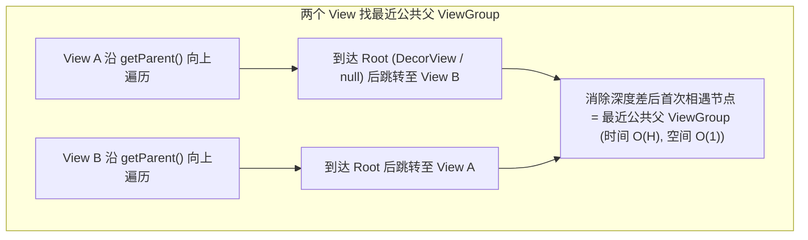

## 面试答题思路

- **算法结合客户端业务的典型考察**：面试官让写“计算 View 树最大深度/最深层级节点”或“找两个子 View 的最近公共父容器”，本质都是把 N 叉树/链表题放进 Android 语境里：
  1. **View 树层序遍历（BFS）**：用队列逐层记录当前层 `size = queue.size`，每轮出队一个节点若为 `ViewGroup` 则将其 `0..childCount - 1` 的子 View 入队；适合统计 UI 树最大深度（评估过度嵌套风险）与每层最大节点数；
  2. **寻找两个 View 的最近公共父 ViewGroup（LCA）**：由于 Android 的 **`View` 天然自带 `getParent()` 向上指针**，不仅可以用通用 N 叉树后序递归（时间 `O(N)`），还可以直接转化为 **“两个单链表相交的第一个公共节点”**：沿 `parent` 向上统计深度差对齐或双指针 `pA/pB` 走完互换起点相遇，时间 `O(H)`、空间 `O(1)`！
  3. **高频链表题**：单链表反转（三指针迭代 `prev/curr/next`）、快慢指针找中点与判断有环/入环点（Floyd 龟兔赛跑）、合并两个有序链表（类比 `MessageQueue` 按时间 `when` 排序）。

## 核心原理解析

### 1. View 树 DFS vs BFS 在客户端诊断工具里的应用
- **DFS（递归/显式栈）**：适合**自顶向下绘制与事件分发**（`dispatchTouchEvent` / `draw` / 找指定 `id` 的子 View 命中即剪枝返回）。若要统计每个层级或打印完整视图 Dump，深度过大时可用显式栈 `ArrayDeque` 避免极端嵌套爆栈；
- **BFS（FIFO 队列）**：天然按 UI 层级（Level 0 → DecorView → ContentFrame → 业务容器）由浅入深展开。UI 性能巡检器常在主线程空闲时做 BFS 统计树深（如超过 10 层告警），定位最先出现冗余嵌套的 `FrameLayout`/`LinearLayout` 节点。

### 2. N 叉树 LCA vs 带 `parent` 指针的 View 树交点解法
- **通用无父指针树 LCA（自底向上后序 DFS）**：对当前 `root` 若等于 `p` 或 `q` 直接返回自身；遍历所有 `child` 递归收集非空返回值：若来自两个不同子树均命中则当前 `root` 就是 LCA，若只有一支命中则透传给上层；
- **View 树工程优化解（`O(1)` 空间）**：`View.getParent()` 返回 `ViewParent`（可能是 `ViewRootImpl`，需用 `parent is ViewGroup` 判断边界）。指针 `a` 走到根后跳到 `b`，指针 `b` 走到根后跳到 `a`，两者必然在步数 `lenA + lenB` 内精确停留在最近公共父容器 `ViewGroup` 上（即 **LeetCode 160 相交链表双指针法**）。

### 3. 链表四剑客核心不变量
- **反转链表**：循环不变量是 `next = curr.next; curr.next = prev; prev = curr; curr = next`。若考“每 K 个一组反转”，核心是拆分“找第 K 个尾节点 + 局部反转 + 前后断链重连”，配合哨兵头节点极稳；
- **快慢指针与环入口推导**：`fast` 一次两步、`slow` 一次一步，若相遇则有环；相遇后让一个指针回到 `head`，两指针**同速每次走 1 步**，再次相遇点必为环入口（因为从 `head` 到入口距离 `a` 与从相遇点绕环走到入口同余）。

## 图解流程

## 高频追问与关键词

- **追问 1**：为什么不能简单把 `View.getParent()` 直接强转为 `View` 或 `ViewGroup` 一直向上循环到 `null`？
  - 关键词：顶层 `DecorView` 的 `getParent()` 返回的是 **`ViewRootImpl`**（它实现了 `ViewParent` 接口，但**不是 `View` 的子类**！），直接强转会抛出 `ClassCastException`；正确写法必须判断 `parent is View` 或 `parent is ViewGroup` 作为遍历终点。
- **追问 2**：如何在不使用递归的前提下，用迭代方式实现 View 树的前序遍历并避免 `Stack` 性能开销？
  - 关键词：使用 **`java.util.ArrayDeque`** 代替过时的 `Stack`（`Stack` 继承 `Vector` 每个方法加了 `synchronized`）；前序遍历入栈时要**倒序压入子 View（从 `childCount - 1` 到 `0`）**，出栈才会保持自左向右、自上而下的绘制顺序。

## 延伸参考

参考 Android Developers `ViewGroup` API 文档与布局层级优化指南。
