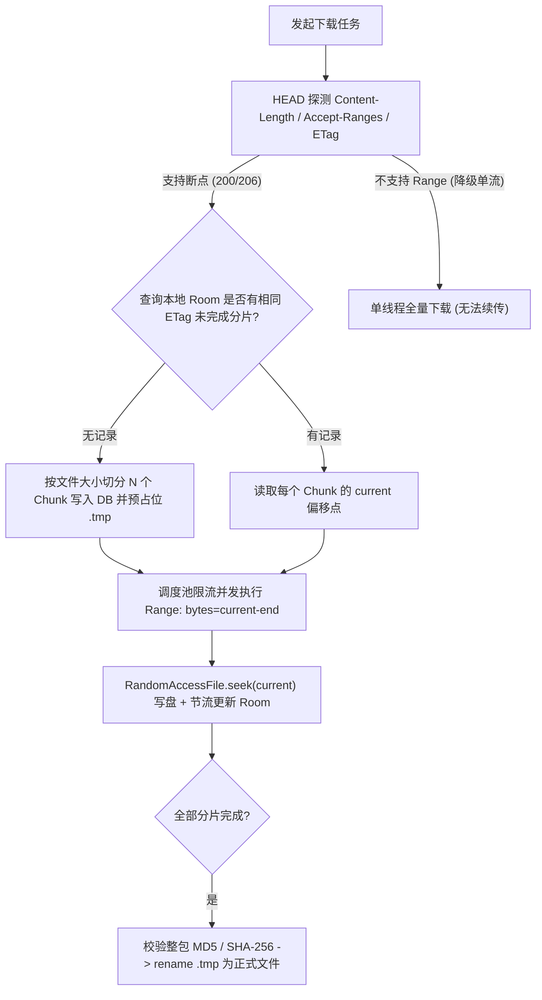

## 面试答题思路

- **高分回答结构（自顶向下四层架构）**：
  1. **协议探测与分片（Protocol）**：先发 `HEAD` 请求确认服务端返回 `Accept-Ranges: bytes`、`Content-Length` 与 **`ETag`/`Last-Modified`**（标识文件版本）；按文件大小动态分片（如每片 2–5MB，设置并发线程上限防撑爆连接池），请求头携带 **`Range: bytes=start-end`**，合法断点响应状态码必须是 **`206 Partial Content`**；
  2. **存储与防损坏（Storage）**：磁盘优先使用 **`RandomAccessFile("rw")` + `seek(start)`**（或 `FileChannel`）按分片偏移并发直写临时文件 `.tmp`，全部完成后再校验 MD5 并原子重命名 `renameTo` 为目标文件；
  3. **进度持久化（State Machine）**：用 **Room/SQLite** 记录每个 `Task` 与 `Chunk(start, current, end)` 的下载状态（`IDLE / DOWNLOADING / PAUSED / COMPLETED / FAILED`）；注意**不能每写一个 8KB Buffer 就写数据库**，而应在内存累积进度，按时间间隔（如每 500ms）或步长（每 256KB）或暂停/异常退出的 `finally` 块里节流刷库；
  4. **调度与系统保活（Scheduler）**：线程池/协程限制全局最大任务并发数，UI 层通过 `Flow` 订阅节流后的进度百分比，长耗时后台下载交由 **`WorkManager`（支持前台通知 + 仅 Wi-Fi 约束）**。

## 核心原理解析

### 1. 断点续传如何防止“文件被服务端更新过”导致拼接错乱？
这是面试官最喜欢追问的线上真实问题：昨天下载了一半的 APK，今天服务端覆盖发布了一个新包怎么办？
- 探测或续传请求时附带 **`If-Range: <ETag or Last-Modified>`** 请求头（或本地对比上次保存的 `ETag`）。
- 如果服务端文件未变，服务器正常返回 `206` 继续拼写旧 `.tmp`；如果服务端文件已更新，服务器会自动返回 **`200 OK`** 全量新流（或校验 ETag 不匹配），此时客户端必须立即清空旧分片数据库并从字节 0 重新下载，避免两代文件字节拼接引发静默损坏。

### 2. 弱网断电后的真实落盘偏移量（崩溃重进不丢片也不写花）
- **为什么不能先更新数据库里的 `downloadedBytes`，再去写磁盘文件？** 如果顺序反了，进程突然崩溃/强杀，数据库认为写完了但 OS Page Cache 里数据还没刷进硬盘，续传就会产生一段全 `0` 空洞！
- **正确原子序**：必须在每次 `RandomAccessFile.write()` 成功返回后再累加内存中的 `chunkCurrentOffset`，并在暂停、切后台或定时检查点再持久化；即便极端崩溃导致上次未及保存最后几百 KB，也只会**多重复下载这几百 KB 覆盖同一物理偏移位置**，由于写入是幂等的（相同 `offset` 覆盖写），最终文件依然 100% 字节正确。

## 图解流程

## 高频追问与关键词

- **追问 1**：磁盘空间不足或文件极大（比如 2GB）时，`setLength()` 预分配好还是边下边长好？为什么不能在所有场景下盲目用 `mmap` 写盘？
  - 关键词：下载启动前优先做 `StatFs` 可用空间校验并适当预留余量，`setLength()` 可提前发现磁盘不足且减少磁盘碎片；但 Android 32 位进程（及某些 OEM 环境）虚拟地址空间极其有限，把整个 2GB `.tmp` 文件做 `mmap` 映射极易耗尽虚拟内存地址空间引发 OOM，采用 **`RandomAccessFile` / `FileChannel.write` 分片写 Buffer** 才稳健。
- **追问 2**：UI 上几十个任务同时下载，进度条高频刷新导致列表卡顿怎么治？
  - 关键词：**背压与 UI 节流（Throttle / Conflate）**；底层字节读取线程按每 200ms 或每变动 >= 1% 向主线程发送一次汇总进度，配合 `RecyclerView` 的 **`notifyItemChanged(pos, payload)`** 局部刷新进度条与文字，绝对避免触发整个 Item ViewHolder 重绘与重布局。

## 延伸参考

参考 MDN HTTP Range 请求规范与 Android WorkManager 后台长任务官方文档。
