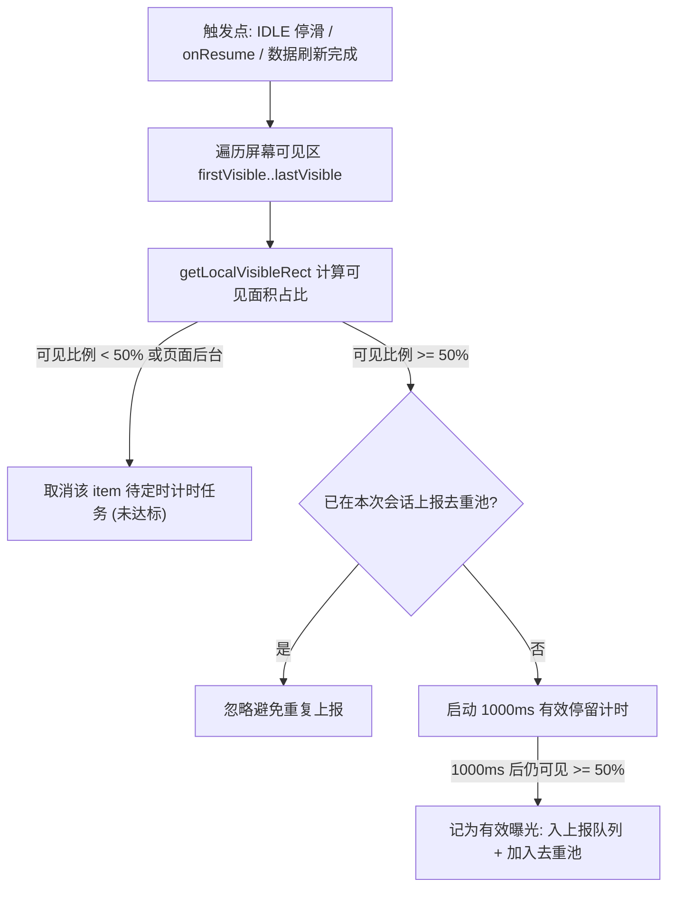

## 面试答题思路

- **Feed 流“卡顿 + 闪烁 + 漏报”三连问的标准拆解维度**：
  1. **防卡顿（保住 60/120fps）**：数据源端做**异步 `DiffUtil` 差分**与 ViewData 文本排版/富文本 **`PrecomputedTextCompat`** 预计算；容器端统一调大复杂 `ViewType` 的 **`setMaxRecycledViews`** 与共享 `RecycledViewPool`；快速 Fling 期间暂停 Glide 新图片解码和信息流视频预播，停稳后再恢复；
  2. **防闪烁（彻底根治复用错乱）**：确保 **`DiffUtil.ItemCallback` 的 `areItemsTheSame` 与 `areContentsTheSame` 准确区分**，刷新局部点赞/倒计时必须传 **`payload`** 走局部绑定；启用 `SimpleItemAnimator.supportsChangeAnimations = false` 关闭默认跨帧交叉淡入淡出动画；异步加载图片前在 `onBindViewHolder` 先重置占位图并用 Tag/RequestManager 解绑旧请求；
  3. **精准曝光埋点（防虚高、防遗漏）**：基于 `OnScrollListener` + `RecyclerView.getChildVisibleRect` 计算可见面积比例（如 `>= 50%`），配合定时/延迟检查满足停留时长（如 `>= 1000ms`）才记作有效曝光；同一屏/同会话内靠唯一 `traceId` 集合去重，切后台 `onPause`/滑动快速划过则立即取消计时，仅在真正脱离视口再重入时决定是否重新计量。

## 核心原理解析

### 1. 为什么滑动刷新时点赞数一变，整张卡片（含大图）会闪一下？
`RecyclerView` 默认动画器 `DefaultItemAnimator` 的 `supportsChangeAnimations` 为 **`true`**。当不传 `payload` 调用 `notifyItemChanged` 或 `areContentsTheSame` 返回 `false` 时，动画器会同时保留**旧 `ViewHolder` 和一个新 `ViewHolder`** 做交叉 Alpha 动画！图片再重新请求闪现就会肉眼明显跳闪。
- **解法**：`DiffUtil.getChangePayload()` 返回精确变动字段（如 `"LIKE_COUNT"`），在三参数 `onBindViewHolder(holder, pos, payloads)` 里检测到 `payloads.isNotEmpty()` 只更新赞数 TextView 跳过图片重绑；同时关闭 `supportsChangeAnimations = false`。

### 2. 如何做高可信度、低性能损耗的信息流曝光埋点？
直接在 `onBindViewHolder` 里报曝光是**完全错误**的，因为 RecyclerView 预取机制（`GapWorker` / `Prefetch`）会在 Item 还没进入屏幕时就提前执行 `onBindViewHolder`！
- **完整可见性状态机**：
  1. **监听时机**：在 `SCROLL_STATE_IDLE`、初始首屏渲染完（`post` 或 `OnGlobalLayoutListener`）、页面 `onResume`/`onPause` 以及新数据 `submitList` 回调这 4 个节点扫描当前屏幕 `firstVisible..lastVisible` 的所有可见 Child；
  2. **双条件判断**：调用 `child.getLocalVisibleRect(rect)`，只有当 `visibleArea / totalViewArea >= 0.5f` 且 **`child.isShown`** 为真时，记录该卡片进入视口的时间戳 `enterTime` 并抛一个 1000ms 延迟校验；
  3. **离屏撤销与去重**：一旦在 1000ms 到达前该卡片滑出有效可见区或整个 Fragment `onPause()`，立即从候选集移除计时器；满 1000ms 仍留在有效区才写入本地批量上报队列并打标 `reportedIds.add(item.id)` 防止同一 Feed 流重复计数；切页回来或下拉刷出新内容按业务口径决定是否清空去重池。

## 图解流程

## 高频追问与关键词

- **追问 1**：列表快速滑动（Fling）时，每帧都计算所有 Child 的 `Rect` 会卡顿吗？如何优化？
  - 关键词：只在 **`SCROLL_STATE_IDLE`** 停稳以及 **滚动节流（如累计滑动超过半屏或每隔 150–200ms 采样一次）** 执行可见比例计算，绝不在每一次 `onScrolled` 像素级回调里全量遍历构建新 `Rect` 对象（复用单 `Rect` 实例，零 GC 分配）。
- **追问 2**：多 Tab 同构 Feed 页如何显著优化首次切 Tab 时的卡顿？
  - 关键词：**跨 Tab 共享全局 `RecycledViewPool`**，同时切忌在共享 Pool 里对 `LinearLayoutManager` 遗漏 `setRecycleChildrenOnDetach(true)`；并针对高频卡片提前做异步视图预填充（`AsyncLayoutInflater` 或闲时 `ViewCacheExtension`）。

## 延伸参考

参考 Android Developers RecyclerView 开发与渲染性能优化文档。
