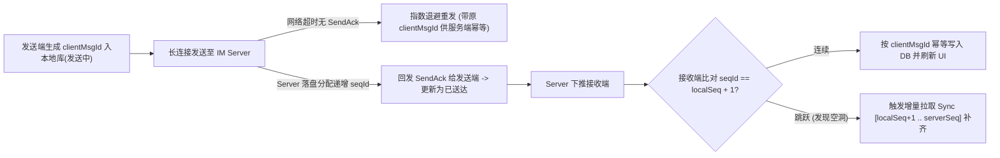

## 面试答题思路

- **IM 可靠性的三大黄金约束：“不丢、不重、有序”**（端到端 ACK + 唯一 ID + 序列号补洞缺一不可）：
  1. **不丢（端到端 ACK 确认）**：发送方发出消息同时开启**应用层超时计时（如 5–10s）**，服务器写入离线库落盘后回送 `SendAck`（而非 TCP 发送缓冲区成功就算成功！）；超时未收到 ACK 触发指数退避重传，超阈值标记发送失败供用户重发；
  2. **不重（客户端本地 `clientMsgId` 幂等去重）**：弱网重传极易导致服务端收到两份或客户端重复拉到同一条消息。发送端用 **UUID + 用户ID + 递增序号**生成唯一 `clientMsgId`，服务端与接收端数据库对其建**唯一索引**，重传相同 ID 直接幂等覆盖或丢弃；
  3. **有序（`seqId` 排序与缺洞补偿 Sync）**：不依赖各手机本地错误的时间戳排序，而由服务端为每个会话/用户分发**单调严格递增的 `seqId`**；客户端收到推送后对比本地 `lastSeqId`：若正好 `+1` 直接落库上屏；若发现 **`serverSeq > localSeq + 1` 说明中间丢包有空洞**，立刻发增量拉取请求 `[localSeq + 1 .. serverSeq]` 补齐后再统一刷新展示！

## 核心原理解析

### 1. 弱网与 Doze 下的连接保活与心跳自适应
- **为什么不能用固定短心跳（如 15s）也不敢直接用超长心跳（如 10min）？**：移动运营商 NAT 网关空闲超时回收周期不同（移动/联通 4G/5G NAT 映射表通常 2–5 分钟失效，Wi-Fi 路由器可能更短）；固定短心跳会疯狂唤醒手机基带耗电，固定长心跳则会导致连接在网关被静默掐死（“假在线”）。
- **工程智能退避心跳算法（参考微信 Mars 思路）**：初始先以安全基础间隔（如 4.5 分钟）探活；若连续多次心跳 `Pong` 顺利返回，逐步试探性拉长间隔直至接近阈值（如 8–9 分钟）；一旦发生超时断线则迅速退回较短保底步长并切换重连退避（1s → 2s → 4s）。在 Android Doze 模式下（6.0+），重要高优系统推送优先走厂商通道（FCM / 华为 / 小米 Push）唤醒，App 在前台时走长连接保活。

### 2. 群聊海量消息优化：“推通知 + 拉取（Push-Pull）”分离
如果群聊几千人瞬间发来 500 条消息，直接把完整消息体全走长连接下推会瞬间打爆终端解码与写库（UI 冻住）。主流 IM 采用**轻通知（Notify Sync）机制**：长连接只推送一条极小的信令 `SyncNotice(maxSeqId)` 告知客户端“你有新消息到 1050 啦”；客户端合并短时间内多个 Sync 通知，打包走一次 HTTP/长连批量请求把 `[1000..1050]` 合并拉回，用一个 SQLite 事务整批写入，极大缓解数据库锁与 UI 刷新风暴。

## 图解流程

## 高频追问与关键词

- **追问 1**：为什么 IM 消息列表的排序和未读数计算不能依赖客户端发消息时的手机本地时间戳？
  - 关键词：客户端时间可被用户手动修改、且存在多设备时区漂移与弱网重传延迟（先发的消息反而后到），必须统一以**服务端落盘时刻分配的严格递增 `seqId`** 作为权威顺序依据，保证多端漫游记录顺序一致。
- **追问 2**：如何在网络切换（Wi-Fi 切 4G/5G）瞬间减少 IM 断线发消息失败率？
  - 关键词：**`ConnectivityManager.NetworkCallback` 监听网络变更 + 多路并发探测重连 + 发送缓冲队列暂存**；监听到网络切换后不傻等老 Socket 几十秒心跳超时才发现假死，主动销毁旧连接并在 2 秒内新建连接，队列中待发的未超时消息自动无缝重推。

## 延伸参考

参考 Android Doze 与电源优化官方文档以及美团移动端长连实践文章。
