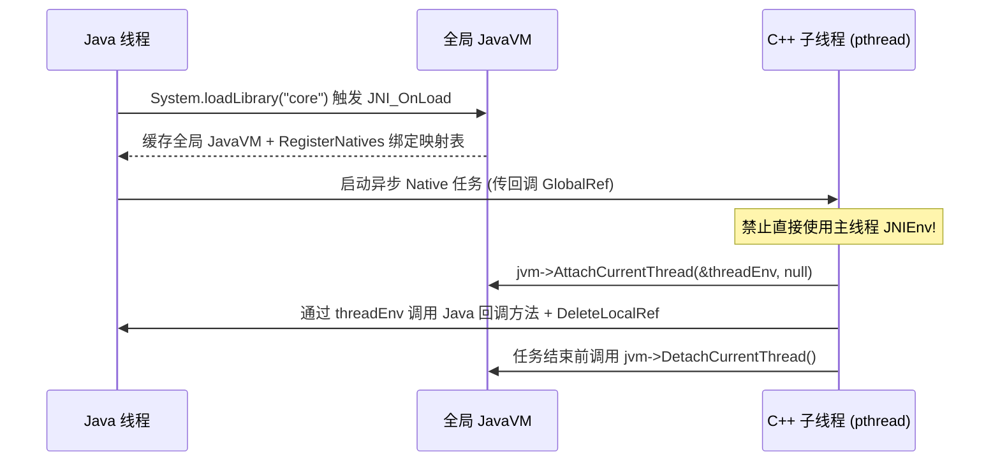

## 面试答题思路

- **JNI 三大核心设计机制**：
  1. **静态 vs 动态注册**：静态注册靠 `Java_包名_类名_方法名` 冗长命名规则在首次调用时由虚拟机动态符号查找，易暴露包名且查找慢；工程正规军使用 **`JNI_OnLoad`** 在 `System.loadLibrary()` 时调用 `RegisterNatives` 主动注册 `JNINativeMethod` 映射表，**加载即绑定、支持 C++ 函数名混淆**；
  2. **`JavaVM` vs `JNIEnv` 线程隔离**：整个进程全局唯一一个 **`JavaVM`**，而 **`JNIEnv`** 是**严格线程私有**的 JNI 方法表指针（绝不可缓存跨线程共享！）。C++ 新开 `std::thread`/`pthread` 回调 Java 前，必须通过全局保存的 `JavaVM->AttachCurrentThread(&env, nullptr)` 为当前 Native 线程临时挂载获取合法的 `JNIEnv`，结束务必 **`DetachCurrentThread`**（否则线程退出会崩溃泄漏）；
  3. **三类引用管理防崩溃**：JNI 层持有的 Java 对象引用（`jobject`/`jstring`）不释放会阻断 GC，尤其局部引用表（`LocalRef`）默认上限极小（经典 ART 曾限制 512 槽位），循环创建不及时释放会直接爆 `JNI local reference table overflow` 崩溃！

## 核心原理解析

### 1. 局部引用（LocalRef）、全局引用（GlobalRef）与弱全局引用（WeakGlobalRef）
- **局部引用（`LocalRef`）**：绝大多数 JNI 函数（`FindClass`、`NewStringUTF`、`GetObjectArrayElement`）返回的默认引用类型。方法返回 Java 时自动批量释放；**致命坑**：在 Native 侧写一个 `for` 循环处理上万张图片或数组元素时，方法还没返回，单次循环生成的局部引用持续累积直到撑爆局部引用表！
  - **解法**：循环内部显式 **`env->DeleteLocalRef(obj)`**，或用 `PushLocalFrame` / `PopLocalFrame` 批处理栈帧回收；
- **全局引用（`GlobalRef`）**：通过 `env->NewGlobalRef(jobj)` 创建，显式阻止 Java GC 回收并允许跨 Native 线程传递，用完必须手动 `DeleteGlobalRef`；常用于缓存 Java 回调对象（注意先 `FindClass` 获取 `jclass` 也必须升为 GlobalRef 才能缓存在静态变量里，局部 `jclass` 方法退出即失效！）；
- **弱全局引用（`WeakGlobalRef`）**：不阻止 GC 回收，使用前必须先调用 `IsSameObject(weakRef, nullptr)` 或转为 `NewLocalRef` 判空保护防野指针。

### 2. Native 线程回调与异常传播坑
C++ 中调用 `env->CallVoidMethod(...)` 若 Java 层抛出异常，**Native 代码不会像 C++/Java 那样立刻中断跳转**，而是处于“挂起异常（Pending Exception）”状态；如果紧接着再调几乎任何其他 JNI 函数会直接引发 ART `CheckJNI` Abort 崩溃！正确规范是在敏感 JNI 调用后检测 `if (env->ExceptionCheck()) { env->ExceptionDescribe(); env->ExceptionClear(); }` 安全兜底。

## 图解流程

## 高频追问与关键词

- **追问 1**：为什么 `FindClass` 在 `pthread` / C++ 子线程里经常找不到我们自己写的 Java 业务类，只找得到 `java/lang/String`？
  - 关键词：**ClassLoader 上下文丢失**；由 Native 主动 `AttachCurrentThread` 附加的新线程没有 Java 调用栈帧，此时 `FindClass` 会退回使用只包含系统类的 **`Bootstrap ClassLoader`**（自然找不到 App APK 里的业务类！）。**标准解法**：在 `JNI_OnLoad` 主线程阶段就把需要的 `jclass` 预先查好并用 `NewGlobalRef` 缓存，或者预先保存一个 App 的 `ClassLoader` 实例全局引用通过 `loadClass()` 加载。
- **追问 2**：`GetStringUTFChars` 和 `GetByteArrayElements` 拿到裸指针后忘记调用 `Release*` 会怎样？
  - 关键词：导致虚拟机要么钉死（Pin）堆内存碎片移动阻断 GC Compaction，要么在无法固定时直接泄漏一份额外拷出来的堆外 C++ 副本；高并发传输大块二进制推荐用 **`DirectByteBuffer`（`GetDirectBufferAddress`）** 实现零拷贝共享物理字节视图。

## 延伸参考

参考 Android Developers 官方 JNI 性能规范与 NDK 核心概念文档。
