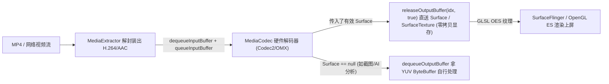

## 面试答题思路

- **一句话讲透 `MediaCodec` 核心模型**：它是 Android 底层连接硬件编解码器（`OMX` / `Codec2`）的异步**生产者-消费者双队列管道**：
  - **解封装端（`MediaExtractor`）** 读取 MP4/MKV 分离出音视频压缩裸流（如 H.264/HEVC NAL 单元），向 `MediaCodec` 申请空闲 **输入缓冲区（`InputBuffer`）** 填入裸包后 `queueInputBuffer` 交给芯片；
  - **硬件芯片（DSP/GPU）** 解码完成后放入 **输出缓冲区（`OutputBuffer`）**；
  - **渲染输出端**：如果 `configure()` 传入了 **`Surface`**（来自 `SurfaceView`/`TextureView`/`EGLSurface`），`releaseOutputBuffer(index, true)` **直接在硬件层面通过 `GraphicBuffer` 零拷贝上屏或进入 OpenGL ES `OES 外部纹理`**，彻底省掉昂贵的 **YUV420 → RGBA 内存拷贝与 CPU 转换**！

## 核心原理解析

### 1. `MediaCodec` 状态机与同步/异步模式
`MediaCodec` 有严格的生命周期状态机：**Uninitialized → Configured → Executing（Flushed / Running / End-of-Stream）→ Released**。
- 在 `Executing` 状态下核心围绕 `dequeueInputBuffer` / `queueInputBuffer` 和 `dequeueOutputBuffer` / `releaseOutputBuffer` 循环运转；
- **重要细节**：首次从 Output 拿到的往往不是视频帧而是 **`INFO_OUTPUT_FORMAT_CHANGED`**，用来读取真实的解码宽高、步长（Stride）和颜色格式；遇到 Seek 拖动进度条必须调 **`flush()`** 清空编解码器管线残留缓存再重新送 I 帧（关键帧）起播，否则会出现严重花屏！
- **推荐模式**：API 21+ 首选 **`setCallback()` 异步回调** 驱动输入输出就绪，避免同步轮询 `dequeue` 设置超时睡死浪费 CPU 或线程空转。

### 2. 为什么传 `Surface` 比自己读 `ByteBuffer` 转码画图快一个数量级？
- 若传 `Surface = null`，解码器会把每帧 YUV 数据拷贝回 Java/Native 可读的 `OutputBuffer`，1080P/4K 视频光在 CPU 里做一次 `YUV → ARGB8888` 与矩阵旋转就会耗掉十几毫秒（直接掉帧发烫）；
- 若在 `configure(format, surface, ...)` 传入绑了 **`SurfaceTexture`** 的 `Surface`：解码芯片直接把输出帧留在底层 `BufferQueue` 的显存级 `GraphicBuffer` 里，`releaseOutputBuffer(idx, true)` 仅传递句柄，`SurfaceTexture.updateTexImage()` 瞬间将其作为 OpenGL ES 外部纹理（`GL_TEXTURE_EXTERNAL_OES`）供着色器叠加滤镜/贴纸后渲染，**全程零 CPU 像素拷贝**。

### 3. 硬件碎片化兜底与硬软切换策略
各手机厂商高通/联发科/麒麟芯片对 `MediaCodec` 分辨率对齐（如必须 16 的倍数）、B 帧兼容、`Profile/Level` 限制各异。工业播放器（如 ExoPlayer / 自研引擎）都会配置**黑名单探测 + 自动降级软解（`FFmpeg` / `libvpx`）**：当 `configure()`、`createDecoderByType()` 或连续解码抛出 `CodecException` 时，无缝切换至软解链路保证用户可播。

## 图解流程

## 高频追问与关键词

- **追问 1**：`SurfaceView` 和 `TextureView` 承载硬解视频时在性能、层级与动画上怎么选？
  - 关键词：**长视频/直播全屏低功耗优先 `SurfaceView`**（拥有独立 `Surface` 与专用合成图层，支持 Hardware Overlay 硬件直通合成省电且延迟少 1 帧，但无法做透明渐变和列表滑动裁切兼容老版本易黑边）；**信息流卡片内小窗播、需要做圆角/缩放旋转动画优先 `TextureView`**（本质是普通 View 层里的 GL 纹理，受 View 树和 `RenderThread` 同步控制）。
- **追问 2**：做视频剪辑逐帧导出（抽帧/转码）时，如何控制解码后按时间精确渲染和编码压帧？
  - 关键词：硬编码输入端使用 **`MediaCodec.createInputSurface()`** 创建编码输入表面，解码端把画面输出到 OpenGL 环境加工后，通过 **`EGLExt.eglPresentationTimeANDROID()`** 给每一帧注入微秒级 PTS 时间戳再 `eglSwapBuffers()` 喂给编码器，保证音画同步与变速剪辑帧率精确可控。

## 延伸参考

参考 Android Developers `MediaCodec` 官方文档与平台多媒体编解码架构指南。
