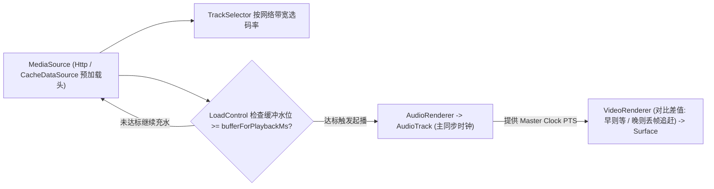

## 面试答题思路

- **ExoPlayer（现集成在 `androidx.media3`）架构四核心组件**：
  1. **`MediaSource`**：定义媒体数据来源与格式封装（支持 MP4、HLS `m3u8`、DASH、合并字幕等）；
  2. **`TrackSelector`**：音视频与字幕轨道选择器，结合 `BandwidthMeter` 估算实时带宽动态切换 ABR 自适应码率；
  3. **`LoadControl`**：核心流控与缓冲水闸，控制何时拉网络流（`minBufferMs`/`maxBufferMs`）、至少攒多少毫秒数据就允许起播（`bufferForPlaybackMs`）以及卡顿后重起播阈值；
  4. **`Renderer`**：具体消费并渲染解码流（`MediaCodecVideoRenderer`、`MediaCodecAudioRenderer` 等），内置音视频同步时钟推进帧刷新。
- **短视频/直播“首帧秒开”四大标准手段**：① **HttpDNS + 连接池预热**；② **列表预加载（滑到第 N 条时后台 `CacheDataSource` 提前拉好第 N+1/N+2 条前 500KB 视频头与第一个关键帧）**；③ **压低 `DefaultLoadControl.bufferForPlaybackMs`**（如从默认 2500ms 降至 500–800ms）；④ **多实例共享或复用全局解码器池减少 Surface 重建阻塞**。

## 核心原理解析

### 1. 音画同步核心原理（谁作为主时钟 Master Clock？）
人耳对声音断续、变调的敏感度**远高于人眼对画面偶尔多停或跳半帧的敏感度**！因此绝大多数播放器（包括 ExoPlayer）都采用 **“视频同步音频时钟（Sync Video to Audio）”** 策略：
- 音频通过 **`AudioTrack`** 稳定向硬件 DSP 输出 PCM 数据，`MediaCodecAudioRenderer` 维护精确的实时音频硬件播放时间戳（`MediaClock`）；
- 视频渲染器每拿出一帧解码图像计算 **PTS（Presentation Time Stamp）与音频主时钟差值**：若超前音频则短暂延迟再渲染；若严重落后（且未到关键帧区间）直接丢帧追赶，音频则按原速自然流畅推进。

### 2. `AudioFocus` 音频焦点冲突与规范礼让
当用户边刷我们 App 的视频边接听电话、导航播报或打开网易云听歌时，App 不能抢不过还强行外放互吵，必须向 `AudioManager` 申请 `AudioFocusRequest`（Android 8.0+ 使用 Builder 构建）：
- **`AUDIOFOCUS_GAIN`**：长视频/音乐播放器申请长期独占焦点，别人抢占时自身暂停；
- **`AUDIOFOCUS_LOSS_TRANSIENT`**：如来电或语音消息，暂时丢失焦点，先暂停播放，待回调 **`AUDIOFOCUS_GAIN`** 后视用户状态恢复；
- **`AUDIOFOCUS_LOSS_TRANSIENT_CAN_DUCK`**：如高德地图突然播报“前方左转”，系统允许短促闪避，播放器把音量临时压低（如调至 `0.2f`）而非生硬暂停，Android 8.0+ 系统层还会辅助自动 Ducking。
- **耳机拔出防外放突变（`ACTION_AUDIO_BECOMING_NOISY`）**：注册广播监听，检测到蓝牙断开/有线耳机拔出立刻暂停，防止在地铁里尴尬外放！

## 图解流程

## 高频追问与关键词

- **追问 1**：刷抖音式上下滑动短视频流，怎么防止多个 `ExoPlayer` 实例切换时内存暴涨或硬件解码器资源耗尽？
  - 关键词：**限容播放器复用池（如限制池内最多 2–3 个实例） + 预加载分离**；硬件 `MediaCodec` 实例数量在系统芯片上有限制（中低端机往往 4–6 个上限就会报资源不足），滑出视口 2 屏以上立刻 `stop()` 并 `release()` 或重置喂给新 URL，下一条视频仅靠 `SimpleCache` 提前预缓存文件头字节到磁盘，不盲目同时创建一堆 `ExoPlayer`。
- **追问 2**：`ExoPlayer` 播放带加密或防盗链鉴权的视频，如何在每次网络分片请求中注入统一动态签名 Header？
  - 关键词：自定义传入 `OkHttpDataSource.Factory` 并挂接共享网络层的 OkHttp 拦截器，或者重写 `HttpDataSource` 的 `DefaultHttpDataSource.Factory` 注入默认请求头，实现所有 `.m3u8` / `.ts` 分片自动带签名及共享 OkHttp 连接池。

## 延伸参考

参考 Android Media3 ExoPlayer 开发文档与音频焦点管理官方规范。
