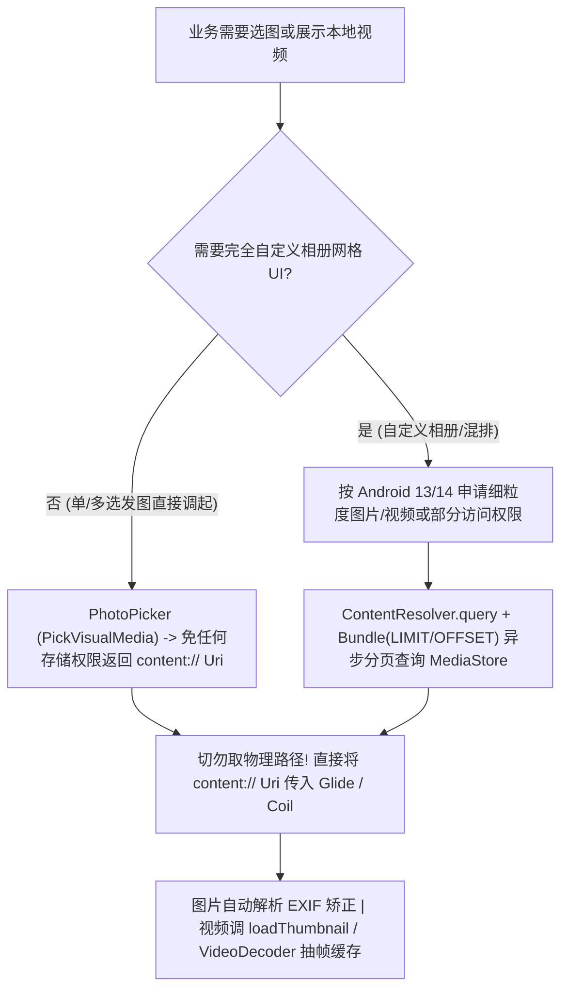

## 面试答题思路

- **媒体库访问演进两大主线（自顶向下讲清晰）**：
  1. **只挑图/挑视频发帖用系统 `PhotoPicker`（最高优先）**：通过 `ActivityResultContracts.PickVisualMedia` 呼起系统级相册选择器，**无需申请任何存储/媒体权限**，系统仅把用户点选的那几张照片通过临时授权 `content://` Uri 返给 App（兼顾 Google Play / 国内隐私合规审查）；
  2. **自定义画廊相册界面需用 `MediaStore` 分页查询**：当产品要求自定义多选排序相册时，申请版本适配权限（`13+` 分拆 `READ_MEDIA_IMAGES` / `READ_MEDIA_VIDEO`，`14+` 叠加 `READ_MEDIA_VISUAL_USER_SELECTED`），再通过 `ContentResolver.query` 查 `MediaStore.Files` / `Images` / `Video` 获取媒体列表与 `content://media/external/.../id` 句柄。
- **高效加载本地媒体与视频缩略图黄金法则**：
  - 查到 **`content://` Uri 后切勿再转真实 `DATA` 物理文件路径**（Android 10+ Scoped Storage 下直接读写他人媒体裸路径极易权限报错），直接把 **`Uri` 传给 Glide/Coil**；
  - 展示相册网格缩略图或视频封面优先利用系统 **`ContentResolver.loadThumbnail(uri, Size, cancelSignal)`**（API 29+）或 Glide 内置 **`VideoDecoder`** / Coil **`coil-video`** 解码器，千万不要自己循环在滑动中创建 `MediaMetadataRetriever` 同步抽帧阻塞列表！

## 核心原理解析

### 1. Android 11+ 查询 `MediaStore` 分页的必踩坑（SQL 拼接崩溃）
- **老写法崩溃点**：早期很多人习惯在 `ContentResolver.query(..., sortOrder)` 的 `sortOrder` 字符串最后直接拼 `"DATE_MODIFIED DESC LIMIT 50 OFFSET 0"`；但从 **Android 11（API 30）起严禁在 SQL 参数里夹带 `LIMIT/OFFSET`**，会直接抛出 **`IllegalArgumentException: Invalid token LIMIT`**！
- **现代正确写法**：在 API 26+ 使用 **`ContentResolver.query(uri, projection, queryArgsBundle, null)`**，通过 `Bundle` 传入 `ContentResolver.QUERY_ARG_LIMIT`、`QUERY_ARG_OFFSET`、`QUERY_ARG_SQL_SORT_ORDER` 以及 `QUERY_ARG_SQL_SELECTION`，并在 Android 10– 下再兜底拼接旧式 `sortOrder`。

### 2. 图片加载器加载本地相册图片与视频封面的内部原理
- **为什么 Glide 直接塞进一个 `content://` 视频 Uri 就能出封面？**：
  Glide 4 注册了 **`MediaStoreThumbnailStreamFetcher`** 与 **`VideoDecoder`**（底层按版本自动桥接 `MediaMetadataRetriever` / `MediaDataSource`），它会识别 MIME 类型为 `video/*`：先查内存与 `DiskLruCache` 磁盘缓存是否已有抽好的封面图，未命中才在后台线程池按 `FRAME_OPTION` 提取一帧关键帧并按 `ImageView` 尺寸（`override`）降采样缩放为轻量 `Bitmap`，支持滑动取消和自动内存复用！
- **EXIF 方向旋转陷阱**：手机竖拍照片很多传感器原图是横的、靠 EXIF `Orientation` 标记旋转 90°。`DATA` 路径手动 `BitmapFactory.decodeFile` 会导致照片横着显示；而交给 Glide/Coil 或 `ImageDecoder`（API 28+）会**自动解析 EXIF 并矫正方向**！

## 图解流程

## 高频追问与关键词

- **追问 1**：用户拍完一张超大图（如 4800 万像素）或从相册选了原图要压缩上传，怎么处理既不 OOM 又保持色彩旋转正确？
  - 关键词：通过 `ContentResolver.openInputStream(uri)` 或 `ParcelFileDescriptor` 读取（避免文件路径不可达），先用 **`ExifInterface(inputStream)`** 记下旋转角或直接使用 API 28+ **`ImageDecoder.createSource(contentResolver, uri)`** 配合 `setTargetSampleSize` 解码出限定边长（如长边 <= 1920px）的 Bitmap，再异步 `compress(WEBP_LOSSY / JPEG, 80)` 输出至应用专属 `cacheDir` 上传。
- **追问 2**：打开自定义相册页面后，如果用户切出去截了屏或拍了照切回来，如何实时感知本地相册新增变化？
  - 关键词：注册 **`ContentObserver`** 监听 `MediaStore.Images.Media.EXTERNAL_CONTENT_URI`（开启 `notifyForDescendants = true`），注意在回调里做防抖（`debounce`）避免连拍瞬间连续刷爆查询，并在 `onDestroy` 及时 `unregisterContentObserver`。

## 延伸参考

参考 Android Developers 共享存储媒体库开发文档与系统 PhotoPicker 指南。
