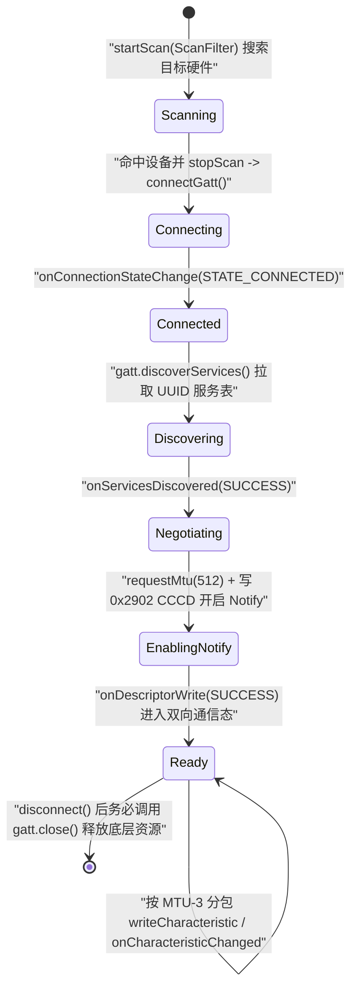

## 面试答题思路

- **BLE 通信本质一句话**：经典蓝牙（BR/EDR）适合连续大带宽音频流（A2DP/HFP），而 **BLE（Bluetooth Low Energy）** 为手环/传感器/IoT 硬件设计，以极低功耗做**间歇性短小控制指令与状态上报**；通信完全遵循 **GATT（Generic Attribute Profile）协议**。
- **Android 连接通信标准五步状态机**：
  1. **扫描发现（`BluetoothLeScanner.startScan`）**：按硬件 `ScanFilter`（UUID/MAC/设备名）和 `ScanSettings`（低延迟/低功耗）扫描周边广播包并及时停扫省电；
  2. **建链（`device.connectGatt(..., gattCallback)`）**：等待回调 `onConnectionStateChange` 状态变为 `STATE_CONNECTED`（**切记此时还不能直接收发数据！**）；
  3. **发现服务（`gatt.discoverServices()`）**：只有 `onServicesDiscovered(status == GATT_SUCCESS)` 回调之后，才能按预设 UUID 拿到目标 `BluetoothGattService` 与其下的读写/通知 **`BluetoothGattCharacteristic`**；
  4. **MTU 协商 + 开启主动通知**：调用 `requestMtu(512)` 拓展单包载荷（默认 MTU 只有 23B，扣掉 3B ATT 协议头单次仅能传 20B）；随后对 Notify 特征调用 `setCharacteristicNotification(char, true)` 并**往其 `0x2902` CCCD Descriptor 写入 `ENABLE_NOTIFICATION_VALUE`**；
  5. **分包双向通信**：写特征发指令（`writeCharacteristic`）并监听 `onCharacteristicChanged` 接收硬件推送通知，长指令按 `(MTU - 3)` 字节切分循环发包与重组。

## 核心原理解析

### 1. GATT 数据层级树（如何向硬件“读写”与“订阅”？）
GATT 是严格的四层树形结构：
- **Profile**：标准服务集合规范（如心率手环 Profile）；
- **Service**（由 128-bit 或 16-bit UUID 标识）：代表一组功能模块（如电池服务 `0x180F`、业务透传服务）；
- **Characteristic**：实际挂载数据的叶子节点（包含 Value 字节数组与权限属性：`READ` / `WRITE` / `WRITE_NO_RESPONSE` / `NOTIFY` / `INDICATE`）；
- **Descriptor**：特征值的附加元数据描述符，最核心的是固定短 UUID **`00002902-...`（CCCD，Client Characteristic Configuration Descriptor）**。

### 2. 开启硬件推送（Notify vs Indicate）常见的两大误区
- **误区 1：只调 `gatt.setCharacteristicNotification(char, true)` 却收不到外设任何数据**！
  `setCharacteristicNotification` 仅打开了**手机本地蓝牙协议栈监听开关**；必须进一步找到特征下的 `CCCD (0x2902)` Descriptor，写入 `ENABLE_NOTIFICATION_VALUE` 并执行 `writeDescriptor()`，物理外设端芯片才会正式开始往手机推数据！
- **误区 2：`Notify` 与 `Indicate` 混淆**。`Notify` 类似 UDP 单向快推不需手机回执，吞吐高；`Indicate` 类似轻量级带 ACK 确认（手机收到后蓝牙协议栈底层强制回 ACK，外设确定收妥再发下一条），适合固件 OTA 校验等严禁丢包指令，此时 CCCD 应写 `ENABLE_INDICATION_VALUE`。

## 图解流程

## 高频追问与关键词

- **追问 1**：为什么 BLE 发送几十 KB 的 OTA 升级固件包或长 JSON 时，默认每次最多只能塞 20 个字节？扩 `MTU` 一定是 512 吗？
  - 关键词：BLE 4.0 基础 ATT 协议规定最小默认 **MTU = 23 字节**，扣除 1B Opcode + 2B Handle 共 **3 字节 ATT 头部开销**，有效载荷（Payload）就剩 **20 字节**。调用 `requestMtu(512)` 发起协商后，实际能扩容多少**由手机芯片与外设硬件双方取最小值决定**（`onMtuChanged(gatt, mtu, status)` 回调里返回的 `mtu` 才是真上限，比如外设只支持 247B，按 `247 - 3 = 244B` 分包切割发送即可）。
- **追问 2**：Android 13（API 33）起对 `writeCharacteristic` 和 `onCharacteristicChanged` API 做了什么重大废弃变更？
  - 关键词：老 API 直接调用 `characteristic.setValue(bytes)` 再 `writeCharacteristic(char)` 存在并发读写脏覆盖同一成员变量的线程安全缺陷；Android 13 新增并推荐使用 **`writeCharacteristic(characteristic, valueBytes, writeType)`** 直接传入当前包独立字节副本，通知回调也新增了带 `value: ByteArray` 参数的新版 `onCharacteristicChanged(gatt, char, value)`。

## 延伸参考

参考 Android Developers BLE 低功耗蓝牙概览与 GATT Server 连接指南。
